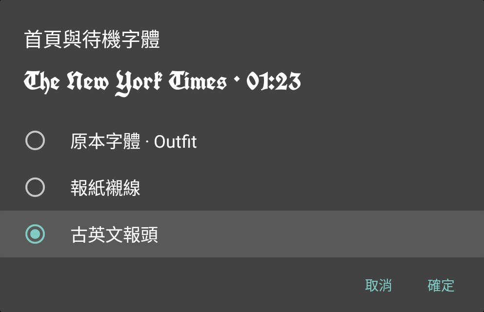

# Chromecast 字體個人版



首頁的桌面設定新增「字體」，可選原本 Outfit、系統報紙襯線與 UnifrakturCook 古英文報頭風格。在選單選取字體後可立即預覽，按確定並返回首頁後套用到首頁文字、App 名稱與待機時鐘。選擇保存在 App 私有偏好，更新 APK 與更換主題後沿用。設定頁使用易讀的系統字體。

UnifrakturCook 提供類似傳統報紙報頭的 blackletter 造型。中文字由 Android 備援字型顯示。原字型檔來自 [Google Fonts](https://github.com/google/fonts/tree/main/ofl/unifrakturcook)，採 SIL Open Font License 1.1，完整授權隨 APK 保存在 [assets](app/src/main/assets/OFL-UnifrakturCook.txt)。字型檔未修改。

此建置重用 launcher 的 Java、資源與測試。公開元件 MainActivity、LauncherSettingsActivity、ClockActivity 透過別名沿用，ClockDream 保留原服務名稱，因此相同簽章的覆蓋更新可保留原有設定。首頁在建立時套用字型，RecyclerView 的新項目在附加時套用。

## 建置

在完整 repository 中，以 Android SDK 34 與 JDK 17 或 21 執行。

```bash
cd personal/chromecast-font-home
./gradlew --no-daemon --no-watch-fs --max-workers=2 testReleaseUnitTest lintRelease assembleRelease
```

輸出為 app/build/outputs/apk/release/app-release.apk，套件 com.gathin.tvhome，versionName 3.5-personal，versionCode 16。採用與參考版相同的本機 debug 簽章。此個人版會將字型、授權與選單一同打包。

選回「原本字體」並返回首頁即可恢復原先外觀。跨版本覆蓋更新需使用相同簽章，且 versionCode 至少為目前安裝值。

## 每週壁紙與系統資訊

桌面設定的「每週壁紙組合」預設每週一依電視本地時間交替 A、B 兩組，每組十張。每組內沿用原輪播間隔。可固定某組或顯示全部，選擇組合會恢復整組輪播，之後選擇單張桌布可覆蓋每週模式。壁紙素材位於 [星空主題](../chromecast-space/README.md)。

「系統資訊」提供裝置、系統與首頁版本、可用記憶體、首頁 PSS、儲存空間、網路、VPN、解析度、時區與運作時間。開啟頁面或按重新讀取時更新。

「設定備份」可建立及還原本機首頁備份，也能查看已配對 Mac 最近同步到 Git 的提交。每台 Git 設定檔與同步方式見 [裝置首頁設定](../device-profiles/README.md)。
