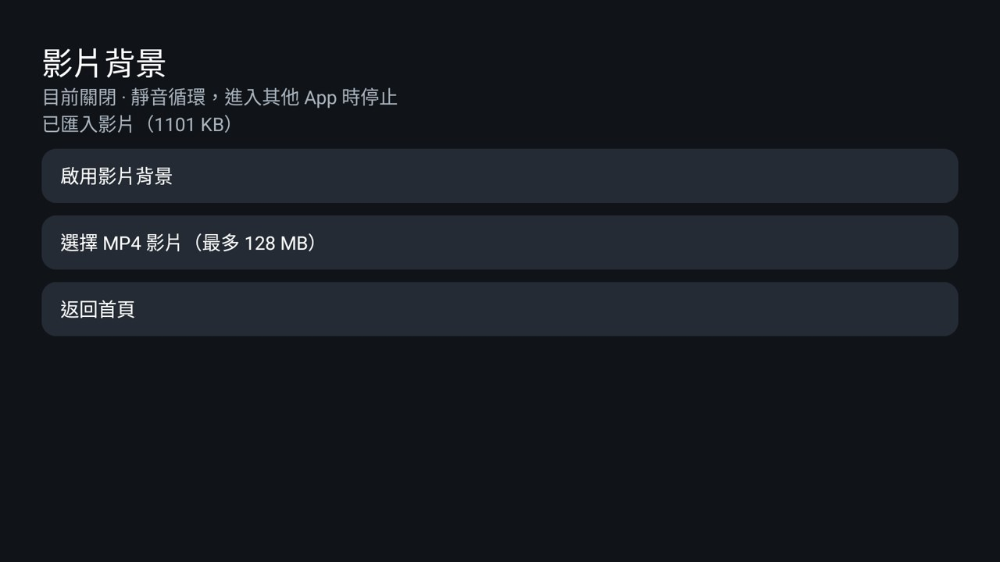

# Sony 影片背景個人版

這是選用的個人版首頁建置，重用參考版的 Java 與資源，在獨立專案中加入本機影片背景。



## 使用

首頁 → 桌面設定 → 影片背景，可開關靜音循環播放。預設關閉，關閉時使用現有照片輪播。進入其他 App、設定或待機畫面時釋放播放器，返回首頁後重新播放。背景影片使用硬體解碼能力，採置中裁切填滿畫面，首頁背景亮度仍控制暗化程度。

可選擇最多 128 MB 的本機 MP4。若電視的檔案選擇器只是系統空殼，選片按鈕會提供電腦匯入說明。驗證時另外匯入 Mozilla 的 CC0 花卉影片。示範片保存在 App 專用儲存空間。[影片來源](https://interactive-examples.mdn.mozilla.net/media/cc0-videos/flower.mp4)

## 六個影音快捷鍵

首頁 → 桌面設定 → 6 個影音快捷鍵，提供六個欄位。選擇欄位後可記錄實體按鈕、命名，以及指定短按與長按開啟的 App。記錄頁只在前景等待按鈕，返回即可取消。YouTube 與 myVideo 的 Sony scancode 已預填，其餘四個欄位由使用者記錄。主題可將前兩顆分別設為 SmartTube 與動畫瘋。

個人版 Home 輔助服務只處理這六個已記錄的影音鍵。音量、靜音、麥克風、電源、訊號來源與方向鍵保留系統處理。切換自訂 Home 仍沿用視窗事件重新導向。請只啟用 HomeKeyService，保留 InputKeyService 關閉。語音服務是否啟用可由系統查驗，收音及按鍵是否成功喚起仍需使用者以實體遙控器驗證。

## 建置

在完整的這份 repository 內，以 JDK 17 或 21、Android SDK 34 執行。

```bash
cd personal/sony-video-home
./gradlew --no-daemon --no-watch-fs testReleaseUnitTest lintRelease assembleRelease
```

輸出為 `app/build/outputs/apk/release/app-release.apk`。套件仍為 `com.gathin.tvhome`，使用同一台電腦的 debug 簽章，可覆蓋參考版並保留設定。一般版的 APK 上限為 576 KB，影片版單獨建置。影片實作位於此專案，參考版只讓設定頁可被繼承，並加入 Sony scancode 按鍵選單支援。

建置會從參考版 manifest 產生個人版 manifest。保留 `.MainActivity` 與 `.LauncherSettingsActivity` 別名，讓原本的 Home 服務、啟動與設定入口使用新的子類別。其他活動、服務、權限及主題提供者皆來自參考版。

## 電腦匯入

先安裝本機建置的 APK，以已授權的 Google ADB 連線，並指定 `TV_ADB_BINARY` 與 `TV_HOST`。先在電視打開影片設定頁，使舊影片停止，再執行。

```bash
tools/venv/bin/python -I tools/tv.py --push /path/to/video.mp4 /data/local/tmp/background.mp4
tools/venv/bin/python -I tools/tv.py 'content write --uri content://com.gathin.tvhome.video/background.mp4 < /data/local/tmp/background.mp4'
tools/venv/bin/python -I tools/tv.py 'rm -f /data/local/tmp/background.mp4'
```

匯入完成才替換原檔，會檢查容量與空檔案，完成後以原子替換方式套用。解碼錯誤時回到照片背景。

## 權限與驗證

沿用參考版權限，影片以本機檔案解碼，只在首頁可見時播放。影片匯入提供者由 `WRITE_SECURE_SETTINGS` 保護，只接受 `background.mp4`。一般 App 無法直接寫入。

實機為 Sony KM-55X85L，Android 12 台灣 S158。驗證項目包括開關、正常設定入口、靜音循環、離開首頁釋放解碼器，以及回到照片背景。一般版與影片版分別執行單元測試及 lint，另有匯入失敗不破壞前一檔案的測試。

## 還原

先在影片設定頁關閉功能，可立即回到照片輪播。需要回到參考版時，使用相同簽章的本機參考版 APK 覆蓋安裝，再重新啟用原本的 Home 輔助服務。影片資料保存在 App 專用儲存空間，覆蓋更新會保留。
